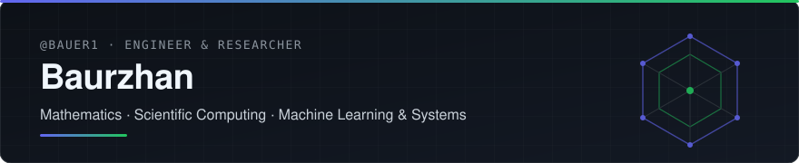

<div align="center">



<p>
  <a href="mailto:bauyrzanzumabaj654@gmail.com">
    
  </a>
  <a href="https://github.com/Bauer1?tab=repositories">
    
  </a>
</p>

</div>

```text
       /\        baurzhan@bauer1
      /  \       --------------------------------------------------
     / /\ \      Role     : Data Scientist / ML Engineer
    / ____ \     Focus    : Deep Learning, Quant ML, Scientific Computing
   /_/    \_\    Core     : Python · PyTorch · C++20 · C
                 Interests: Time-Series, Computer Vision, PDEs, Tensors
  [ math + code ] Status  : Open to interesting ML & systems problems
```

---

### Featured Projects

#### [`TensAxon`](https://github.com/Bauer1/TensAxon) — Header-Only `constexpr` C++20 Linear Algebra & Tensor Library
> Fixed-size, stack-allocated `Vector`, `Matrix`, and `Tensor<T, Dims...>` types where shapes are encoded directly in the type system — turning dimension mismatches into **compile-time errors**.
- Implements partial-pivoted LU factorization, one-sided Jacobi SVD (with rank & pseudoinverse), linear system solvers, and arbitrary-rank tensor contractions (`contract`, `outer`, `hadamard`).
- Zero external dependencies, fully `constexpr`, tested with CI.
- **Stack:** `C++20` · `Header-only` · `MIT`

#### [`fin-nn`](https://github.com/Bauer1/fin-nn) — Leak-Free Deep Learning for Equity Direction Forecasting
> End-to-end PyTorch pipeline forecasting next-day `NVDA` closing price direction from a 30-day lookback window of causal technical and volatility indicators.
- Built around quantitative research discipline: strict causal feature engineering, automated look-ahead leakage unit tests, chronological train/val/test regime splits, and `StandardScaler` fit strictly on training data.
- Benchmarks a 2-layer `GRU` against `Logistic Regression` and naive baselines.
- **Stack:** `Python 3.12+` · `PyTorch` · `uv` · `Ruff` · `pytest`

---

### Selected Earlier Work

| Project | Focus | Stack |
|---|---|---|
| [**PDF-Glyph-Restoration**](https://github.com/Bauer1/PDF-Glyph-Restoration) | Convolutional denoising autoencoder restoring degraded characters in scanned PDFs | `PyTorch` · `Pillow` |
| [**logistics-queue-ai-agent**](https://github.com/Bauer1/logistics-queue-ai-agent) | AI control tower for logistics queues, dock scheduling, and detention prediction | `Python` · `AI` |
| [**bank-violation-detector**](https://github.com/Bauer1/bank-violation-detector) | Detects visual indicators of potential violations in bank cash operations | `Python` · `CV` |
| [**pde-solver**](https://github.com/Bauer1/pde-solver) | Numerical solver for partial differential equations | `C++` |
| [**Trackify**](https://github.com/Bauer1/Trackify) | Expense tracker with category, daily, and monthly analytics | `Flask` · `SQLite` · `Chart.js` |
| [**game-of-life**](https://github.com/Bauer1/game-of-life) | Conway's Game of Life cellular automaton | `C` |

---

### Tech Stack

| Area | Tools |
|---|---|
| **Languages** |      |
| **ML & Scientific** |    |
| **Web & Tooling** |      |

---

<div align="center">
  
  
</div>
